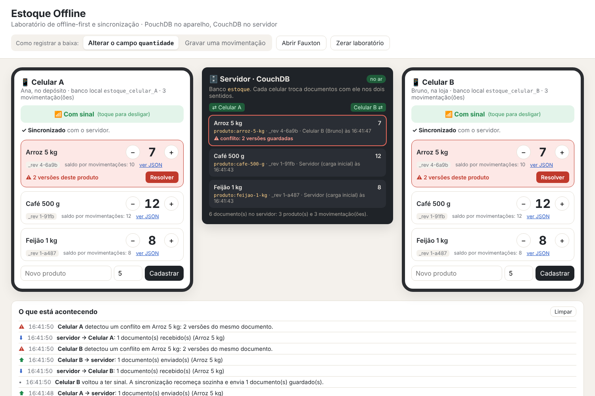

# Estoque Offline: PouchDB + CouchDB

Laboratório do seminário de **Banco de Dados NoSQL** (UTFPR Guarapuava, 2026/2).
**Tema 6: Offline e sincronização.** Apresentação em **17/11/2026**.

> **Contexto para a dupla:** este sistema **não é cobrado** pelo professor (o seminário não tem
> demonstração ao vivo). Ele existe para **entendermos o tema na prática** e para **tirarmos os prints
> dos slides**. Nos slides, os exemplos são da situação do **GastroHub** (entregador no subsolo) e do
> nosso projeto **Bora Lá UTFPR** (motorista sem sinal finalizando a corrida). O estoque é só o jeito
> mais fácil de ver o mecanismo funcionando.



---

## O que o sistema mostra, em 1 minuto

A tela simula **dois celulares** e o **servidor** no meio:

```
 📱 Celular A (Ana)          🗄️ Servidor CouchDB          📱 Celular B (Bruno)
 banco local PouchDB  ⇄  banco "estoque" (cópia  ⇄  banco local PouchDB
                          compartilhada)
```

- **Offline-first:** cada celular lê e grava **no próprio banco** (PouchDB, salvo no navegador). Ele nunca espera a rede.
- **Sincronização:** em segundo plano, cada celular troca documentos com o CouchDB **nos dois sentidos**.
- **Sem sinal:** o botão *Com sinal / Sem sinal* corta a sincronização daquele celular. Continua dando
  para gravar, e tudo sobe quando o sinal volta.
- **Revisões (`_rev`):** cada alteração gera uma revisão nova do documento (`1-...`, `2-...`).
- **Conflito:** se os dois celulares alterarem o mesmo produto sem sinal, o CouchDB **guarda as duas versões**
  e escolhe uma vencedora provisória. O botão **Resolver** mostra as 3 estratégias: *a última escrita
  vence*, *mesclar* e *perguntar ao usuário*.
- **Modo movimentações:** cada baixa vira um documento novo e o saldo é a soma. Assim **não existe conflito**.
- **Log "O que está acontecendo":** explica em português cada envio (⬆), recebimento (⬇) e conflito (⚠).

---

## Como executar no seu PC (Windows)

### 1. Instale o Node.js
https://nodejs.org → versão **LTS** → instalar com as opções padrão.
Para conferir, abra o Prompt de Comando e digite `node -v`.

### 2. Instale e configure o CouchDB
1. Baixe o instalador **Windows (x64) `.msi`** em https://couchdb.apache.org/#download.
2. Quando ele pedir usuário e senha de administrador, use **`admin`** / **`admin`**. Deixe instalar **como serviço**.
3. Abra **http://127.0.0.1:5984/_utils** (o Fauxton, painel do CouchDB) e entre com `admin` / `admin`.
4. Menu **Setup** → **Configure a Single Node** → mesmo usuário e senha → **Configure Node**.
   A tela deve mostrar *"Apache CouchDB is configured for production usage as a single node!"*.

> Se usar outra senha, altere o arquivo `config.json`.

### 3. Baixe este repositório
```bash
git clone https://github.com/Gabriel-Afinovicz/estoque-offline-utfpr-bdnosql.git
```
Ou, no GitHub: botão verde **Code → Download ZIP**, e depois extraia.

### 4. Rode
Dê **dois cliques em `iniciar.bat`**. O Windows pode mostrar só `iniciar`, com ícone de engrenagem.
Se aparecer *"O Windows protegeu o computador"*, clique em **Mais informações → Executar assim mesmo**.

Ou pelo terminal, dentro da pasta:
```bash
npm start
```

Uma janela preta mostra *"Estoque Offline rodando!"* e o navegador abre em **http://localhost:8080**.
O painel do servidor (no meio) deve mostrar o selo **"no ar"** em verde.
Para parar, feche a janela preta ou aperte `Ctrl + C`.

> **Não precisa `npm install`.** O projeto não tem dependências: o PouchDB já vem em `public/vendor/`.

---

## O que fazer depois de rodar

1. Leia e faça os **6 experimentos do [`LEIA-ME.md`](LEIA-ME.md)**: offline, revisões, conflito,
   as 3 formas de resolver, a modelagem que evita conflito e onde o offline **não** serve.
   Façam juntos e **expliquem em voz alta um para o outro**: o professor faz pergunta para cada um,
   inclusive sobre a parte do colega.
2. Siga o **[`ROTEIRO-PRINTS.md`](ROTEIRO-PRINTS.md)** para tirar os prints de cada parte do seminário.
   Os essenciais são P2, P6, P7, P8, P9 e P11.
3. O botão **Zerar laboratório** volta tudo ao começo (3 produtos) sempre que precisar.

---

## Como o projeto está organizado

```
├── iniciar.bat            ← dois cliques para rodar (Windows)
├── server.js              ← entrega a página e repassa /couch/... para o CouchDB, já com a senha
├── config.json            ← endereço, usuário e senha do CouchDB, porta do app
├── package.json           ← só o script "npm start"
├── public/
│   ├── index.html         ← a tela
│   ├── style.css
│   ├── app.js             ← toda a lógica: sync, offline, conflitos, movimentações (comentado)
│   └── vendor/pouchdb.min.js   ← PouchDB 9
├── LEIA-ME.md             ← instalação detalhada + roteiro de estudo (6 experimentos)
└── ROTEIRO-PRINTS.md      ← prints para os slides, por parte da especificação
```

**Por que existe o `server.js`?** O navegador não pode falar direto com outro endereço (o CouchDB, porta
5984) sem configurar CORS. O `server.js` serve a página na porta 8080 e repassa as chamadas de `/couch/...`
para o CouchDB, já com o usuário e a senha. Ele não usa nenhuma biblioteca, só o Node.js.

### O coração do código (em `public/app.js`)
```js
const local = new PouchDB('estoque_celular_A');                  // banco dentro do aparelho
const servidor = new PouchDB(location.origin + '/couch/estoque'); // CouchDB

local.sync(servidor, { live: true, retry: true });                // sincroniza nos dois sentidos

await local.put(produto);                                         // grava SEMPRE no local
const doc = await local.get(id, { conflicts: true });             // doc._conflicts = versões concorrentes
```

---

## Problemas comuns

| Sintoma | Solução |
|---|---|
| Servidor **fora do ar** | Abra http://127.0.0.1:5984. Se não responder: *Serviços do Windows* → iniciar **Apache CouchDB**. |
| Erro 401 / senha | Usuário e senha do `config.json` precisam ser os do CouchDB. |
| `node não encontrado` / janela fecha sozinha | Instale o Node.js LTS. |
| Porta 8080 ocupada | Mude `"porta"` no `config.json` e acesse o novo endereço. |

---

**Atenção:** o `config.json` tem a senha `admin`/`admin` de propósito, porque é um ambiente de estudo local.
Não usem essa senha em nenhum CouchDB exposto na internet.
